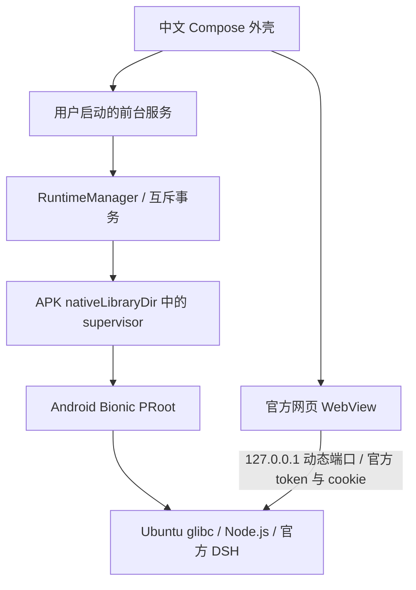

# Tanuki 设计

本项目实现 Android 封装与运行管理。Ubuntu、Node.js、PRoot、官方 DSH 使用各自上游。Mac 只编译组件、构建 APK、安装和采集证据；实际 Ubuntu 命令由 Android App 的普通 UID 创建的子进程执行。

minSdk 26：使用 Android 8 的前台服务、NIO 文件操作、WebView renderer 故障回调等系统能力；并非宣称已在 Android 8 真机通过。compileSdk 34：复用已安装平台，足够声明 Android 14 specialUse 服务。标准 modern 变体 targetSdk 34；compat 的 28 变体仅用于对照实验，标准运行实验成功后不以降低 SDK 为解决方案。唯一实测系统是 API 34 ARM64 Emulator；HyperOS 未连接。

安装、健康、DSH 进程、HTTP 服务与 WebView 认证分别建模。进程活着且网页断开是合法状态。WebView 的 CONNECTED 表示同一回环 origin 的带 cookie HTTP 请求返回 200；不会据此宣称所有 WebSocket 通道或 Agent 任务已完成。任务状态由官方网页展示。

WebView provider、Chromium 版本和 CSS 能力独立于运行环境状态。App 在离线页实际测量 subgrid / light-dark()，未通过 Chromium 123+ 要求时显示升级页面，保持 Linux 与后端状态。更新 AndroidX WebKit 只提供宿主 API，不能升级引擎；本工程不通过修改 CSS.supports 结果宣称支持。

用户可设置启动应用时自动运行上次正常停止的前台服务（默认开启，可关闭）；Activity 只连接它，页面切换不会停止 DSH，不自动刷新运行中的网页。Activity 重建保存 WebView 状态，不能保证官方网页未持久化的输入草稿。启动端口由 `--port 0` 交给系统选择，只有官方就绪日志中精确的 127.0.0.1 URL 可以成为 WebView origin。DSH `web` 启动期可预加载只读路径缓存，官方就绪行或超时后卸载；该缓存只加速启动，不改变文件系统边界。

目录（均在应用私有 files 目录）：

| 路径 | 职责 / 客体映射 |
|---|---|
| runtime/ubuntu | Ubuntu 根目录，系统工具与 apt 状态 |
| runtime/ubuntu.staging | 校验、解包、启动实验暂存目录 |
| runtime/node | 独立 Node.js 组件，映射至 /opt/node |
| runtime/pnpm | 独立 pnpm 工具，映射至 /opt/pnpm |
| runtime/node-cache | Node 编译缓存，映射至 /opt/node-cache，可重建 |
| engines/版本 | npm 安装的固定 DSH 入口及其 lockfile，映射至 /opt/engines |
| userdata/home | /home/tanuki，HOME；包含官方 ~/.agents/skills 等扩展目录 |
| userdata/dsh | /dsh-data，所选版本实际存在的 DSH_HOME，配置、profiles、会话、插件等由官方管理 |
| workspaces | /workspaces，用户项目；独立于 DSH 程序与数据快照 |
| downloads | 经校验的压缩包、.part 与 ETag；不包含模型凭据 |
| backups | 含私有凭据的内部数据快照，不直接公开导出 |
| logs | 有上限的脱敏运行日志 |
| state | AtomicFile 元数据、安装与更新 journal、固定诊断结果 |

概览统一管理 Ubuntu、Node.js 和 DSH。Ubuntu 与 Node 使用独立目录，旧安装在停止服务后迁移；组件重装通过 journal 保留旧目录，候选成功后提交，中断可恢复。Ubuntu 卸载保留 Node / pnpm / 编译缓存，Node 卸载清理这些工具目录，DSH 卸载只移除所选程序版本。项目、HOME 与 DSH 数据不作为组件删除目标。

Ubuntu 与 Node 可各自选择已验证的下载源；所有源下载同一固定版本，使用相同 SHA-256 校验。下载状态包含来源、字节进度、速度；未知总大小不显示伪百分比。DSH 版本来自官方 npm 元数据，备用程序安装不切换正式数据，降级需匹配数据快照。

DSH 全屏只改变原生工具栏、导航和系统栏，不重建 WebView；悬浮按钮与返回键可退出。Node 恢复默认四线程 I/O 池，并将 V8 编译缓存放在私有可重建目录；编译缓存不包含会话快照。

宿主 /dev、/proc、/sys 绑定进客体；不启动 systemd、桌面或 VNC。不将 PRoot 当恶意代码沙箱。外壳不暴露 Shell 输入窗口、第二套聊天框或任意命令 WebView Bridge。底层 PTY 单独通过实际测试核验。

附加工具：apt 安装保存在 Ubuntu 系统；项目 npm 依赖保存在工作区；插件和 Skills 沿用官方机制。当前项目导出只覆盖工作区文件，不覆盖系统工具、会话和账号。私有数据快照覆盖 userdata 及匹配版本元数据，Ubuntu 与 Node 不在其中，因此不能宣称可跨任意依赖组合回退。卸载 App 会删除所有这些私有目录。

项目维护脚本只使用项目 JDK 和 Gradle Wrapper，不修改全局 shell、Java 或 SDK。环境前置和资源条件见 [上手指南](AGENT-QUICKSTART.md)。
